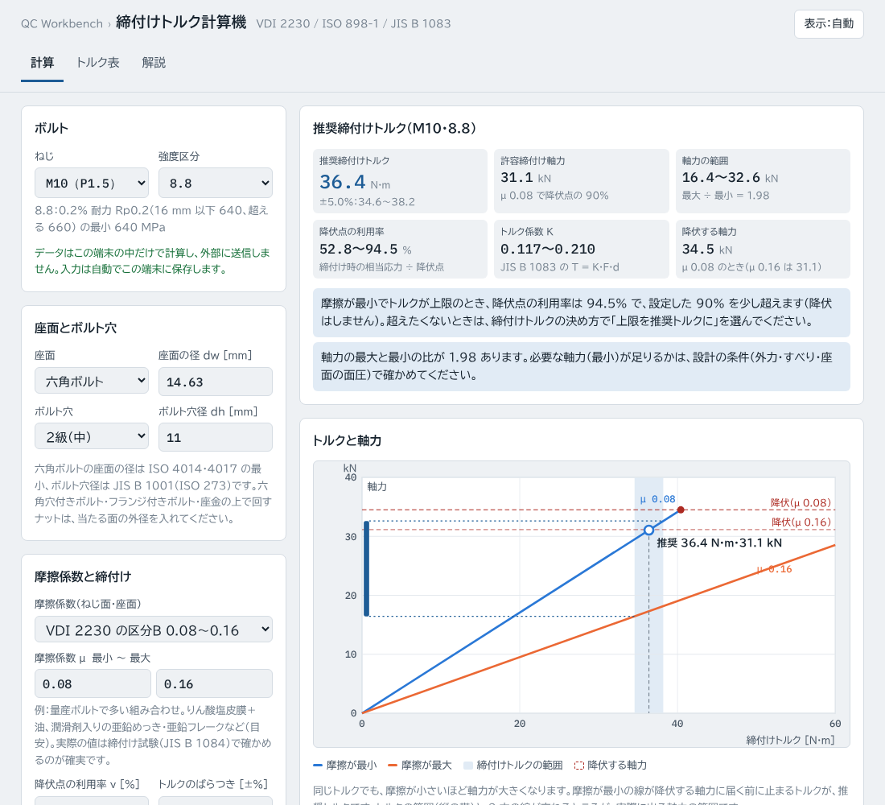
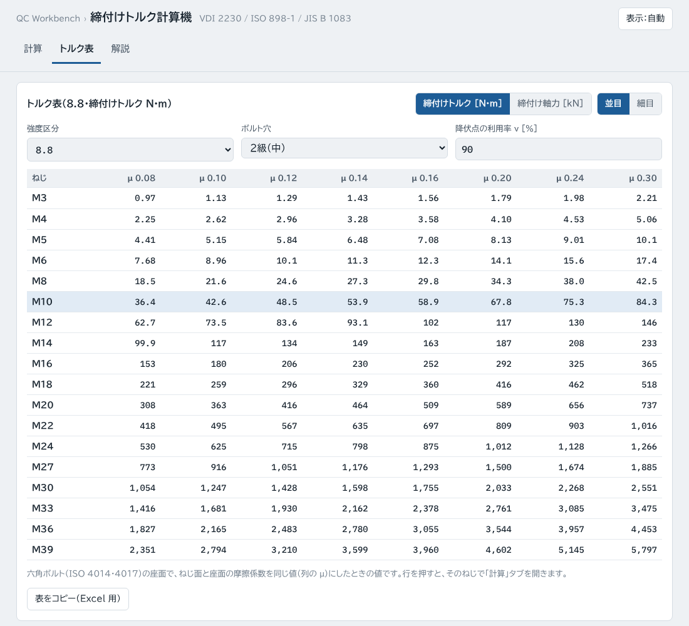

# 締付けトルク計算機（torque-calc）

ボルトのねじ・強度区分・摩擦係数から、VDI 2230 の方法で**推奨締付けトルク**と**締付け軸力**を求める Web ツールです。摩擦係数とトルクのばらつきで軸力がどこまで変わるかを図で示し、強度区分ごとのトルク表も出せます。

**https://kotaooka.github.io/torque-calc/**

インストールは不要で、ブラウザで開くだけで使えます。

- **データは外に出ません**。計算はすべてブラウザの中で行い、どこにも送信しません
- 画面の字体（BIZ UDPゴシック・IBM Plex Mono）は Google Fonts から読み込むため、開いたときに Google のサーバーへ接続します。入力したデータは送りません
- 一度開けば**オフラインでも動きます**。スマートフォンやPCにアプリとして追加することもできます

---

## できること

### 計算

1. **ボルトを選ぶ**：ねじ（並目 M3〜M39、細目 16 種、または呼び径とピッチを入力）と強度区分（鋼 4.6〜12.9、ステンレス A2・A4-50／70／80、または降伏点を入力）
2. **座面とボルト穴**：六角ボルト（ISO 4014・4017）の座面の径と、JIS B 1001 のボルト穴径（1〜3 級）が自動で入ります。六角穴付きボルト・フランジ付きボルトなどは径を入れます
3. **摩擦係数**：VDI 2230 の区分（A〜D）から選ぶか、最小〜最大を直接入れます
4. **締付けの条件**：降伏点の利用率 ν（初期値 90%）と、締付け工具のトルクのばらつき（初期値 ±5%）を入れます

| 出力 | 内容 |
|---|---|
| 推奨締付けトルク | 摩擦係数が最小のとき、相当応力が降伏点の ν 倍になるトルク（VDI 2230 の MA） |
| 指示するトルクの決め方 | 推奨トルクを狙い値にする（メーカーのトルク表と同じ）か、トルクの上限を推奨トルクにするかを選べます |
| 軸力 | 許容締付け軸力、摩擦とトルクのばらつきによる軸力の範囲（最大 ÷ 最小 = 締付け係数 αA）、降伏する軸力 |
| 降伏点の利用率 | 軸力が最小・最大のときの、締付け時の相当応力 ÷ 降伏点 |
| トルク係数 K | JIS B 1083 の T = K·F·d の K |
| 図 | トルクと軸力の関係（摩擦が最小・最大の 2 本の線、降伏する軸力、トルクの範囲）、トルクの内訳（軸力になる分・ねじ面の摩擦・座面の摩擦） |
| 保存 | 結果を Excel 用にコピー |

### トルク表

強度区分・ボルト穴の等級・利用率を選ぶと、並目または細目の全サイズについて、摩擦係数 0.08〜0.30 の締付けトルク（または締付け軸力）の表を出します。行を押すと、そのねじで計算タブを開きます。Excel 用にコピーできます。

---

## 計算の定義

- 許容締付け軸力 FMzul = As × ν × Rp ÷ √(1 + 3 × [1.5 × (d2 ÷ dS) × (P ÷ (π d2) + 1.155 μ)]²)（VDI 2230 Blatt 1:2015 式 (R7)、ねじり応力の係数 kτ = 0.5）
- 締付けトルク M = F × (0.16 P + 0.58 d2 μ + DKm ÷ 2 × μ)、DKm = (dw + dh) ÷ 2（ねじ面と座面の摩擦係数は同じ値）
- 推奨締付けトルクは、摩擦係数の最小で計算します（同じトルクで軸力が最も大きくなる条件）
- 降伏点 Rp は ISO 898-1（JIS B 1051）・ISO 3506-1（JIS B 1054-1）の最小値です

式の意味と例、摩擦係数の目安は、ツールの「解説」タブを見てください。

---

## 使うときの注意

- ボルトが締付けで降伏しないトルクを出すツールです。めねじ（ナット・タップ穴）の強度、座面の面圧、使用中の外力・疲れ・ゆるみは確かめていません
- 伸びボルト（軸部を細くしたボルト）、プリベリングトルク形ナット、回転角法・降伏点締付けには、そのまま使えません
- 12.9（条件によって 10.9 も）に電気めっきをすると、水素ぜい化で遅れ破壊することがあります
- 図面・仕様書・顧客の規格に締付けトルクの指定があるときは、そちらを優先してください
- 計算結果は判断材料としてお使いください

---

## 計算の検証

`tests/test.js`（push のたびに GitHub Actions で実行）で次を確かめています。

- 応力断面積：ISO 898-1 の表の値（M3〜M39 並目、M10×1.25）と一致
- 許容締付け軸力・締付けトルク：VDI 2230:2015 に基づく Bossard の公表トルク表（技術資料 F.053〜F.055。M4〜M39 並目と細目 9 種 × 8.8・10.9・12.9、μ 0.08・0.12・0.14）の 252 個の値と、表示の丸め（表は切り捨て）の範囲で一致。最大の差は M4 のトルク（表 2.3 N·m・計算 2.25 N·m）
- 範囲の計算、決め方の切り替え、ステンレスの強度比、入力の誤りの扱い

開発者向けの情報は [DEVELOPMENT.md](DEVELOPMENT.md) にあります。

## ライセンス

[MIT License](LICENSE)
